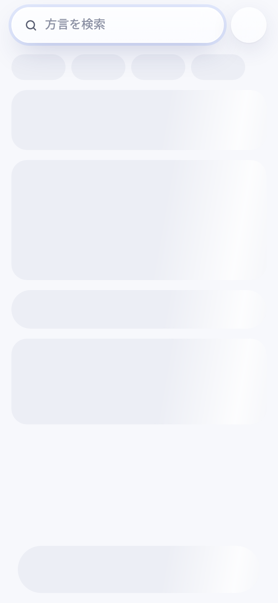
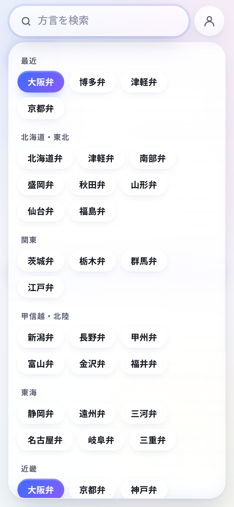
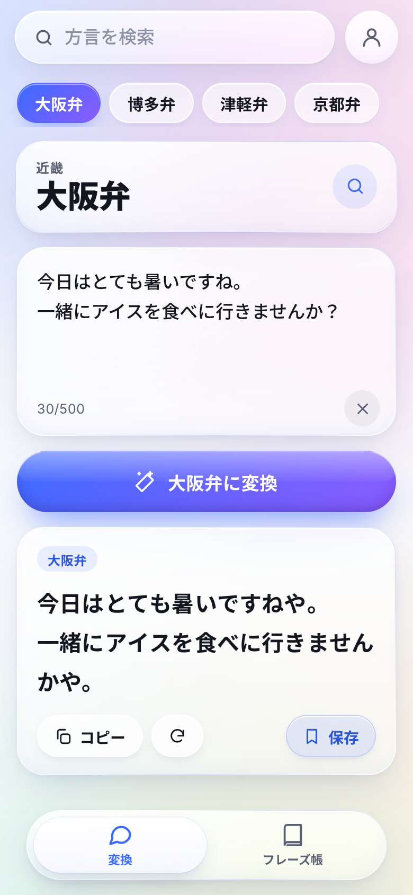
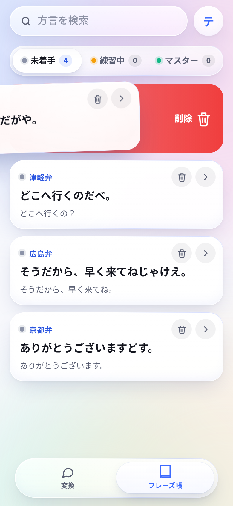
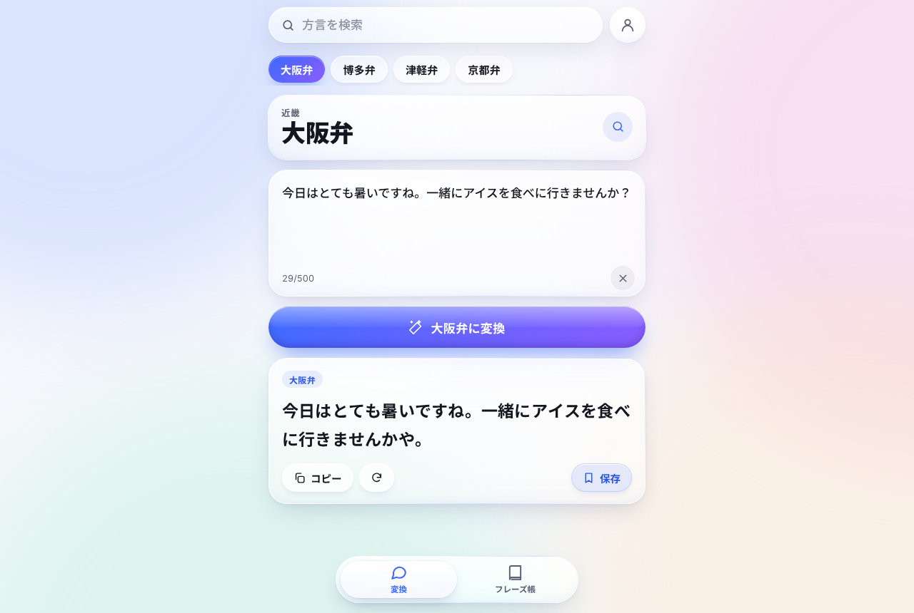

# Namari

共通語を日本各地の方言に変換する Web アプリです。モバイルファーストで作っています。

- 検索バーは開いた瞬間から入力できます（JS 読み込み前でも打てて、起動後に引き継がれます）
- 53 方言＋キャラ口調 5 種。かな・ローマ字・漢字・地方名で探せます
- 変換は Workers AI で行い、1 文字ずつストリーミング表示します
- フレーズ帳では、保存したフレーズを **未着手 → 練習中 → マスター** の 3 段階で管理します。右フリックで進み、左フリックで戻ります。未着手で左フリックすると削除です（取り消せます）
- ログインは Google のみです

| 起動直後（スケルトン） | 検索 | 変換 | フリック | デスクトップ |
|---|---|---|---|---|
|  |  |  |  |  |

> スクリーンショットは静的版（形態素解析による変換）で撮影しました。

この実装の元になった設計プロンプトは [PROMPT.md](PROMPT.md) にあります。

## 2 つの版

| | 静的版（すぐ使える） | フル版（Cloudflare） |
|---|---|---|
| URL | **https://061-ttt.github.io/1/** | `https://namari.<サブドメイン>.workers.dev`（要デプロイ） |
| 必要な登録 | なし（GitHub Pages） | Cloudflare・Google |
| 変換 | 端末内の形態素解析（kuromoji）＋方言文法ルール | Workers AI（検証済みの変換例を few-shot で付与） |
| 方言 | 49 方言＋キャラ口調 5 種（琉球諸語・八丈方言は除外） | 53 方言＋キャラ口調 5 種 |
| ログイン | なし | Google |
| フレーズ帳 | 端末内（ブラウザ）に保存 | アカウントに保存（D1） |

同じソースから `npm run build:static`（`VITE_STATIC=1`）で静的版を作ります。UI・検索・アニメーション・フリック操作は両方で共通です。

### 静的版の変換の仕組み
1. 入力文を **kuromoji**（IPADIC）で形態素解析し、品詞と活用形を得ます。辞書（約 18MB）は初めて変換するときに読み込みます。読み込みは入力欄にフォーカスした時点で始まります
2. 方言ごとの文法プロファイル（`src/shared/engine/profiles.ts`）に従って、**文法的に特定できた箇所だけ**を置き換えます
   - 断定の「だ」（過去の「読んだ」とは区別）、否定「ない」（依頼の「〜ないで」は変えない）、「ている」「てしまう」、存在の「いる」、理由の「から」、推量「だろう」、意志「〜しよう」、「〜なさい」「〜てください」、文末の「よ／ね／よね」、疑問の「の」、形容詞（九州のカ語尾、関東の「すげえ」）、定番語彙
3. 確信の持てない変換はしません。変換できる表現がない文は共通語のまま返し、その旨を表示します。文末に語尾を機械的に付け足すこともしません（キャラ口調を除く）
4. 琉球諸語（沖縄語・宮古語・八重山語）と八丈方言は、共通語と文法・語彙が大きく異なり規則では正しく変換できないため、静的版では選べません（フル版の AI 変換では選べます）

正しさは、**全方言 × 45 文の正解コーパス**（目視レビューに加え、別の担当者が独立に監査）と、意味を変えないことの検査（「読んだ」を変えない、「〜ないで」を否定にしない、語尾を重ねない、句読点・数字・URL を保つ）で、単体テストとして毎回確認しています。

---

## 技術選定と理由

### 全体構成
```
ブラウザ ──▶ Cloudflare Workers（1 つの Worker）
              ├─ 静的アセット配信（Workers Static Assets）
              ├─ /api/*  Hono
              │    ├─ Workers AI   … 方言変換（SSE ストリーミング）
              │    ├─ D1           … ユーザー・フレーズ帳
              │    └─ Rate Limiting … AI 呼び出しの回数制限
              └─ Google Identity Services の ID トークンを JWKS で検証
```

| 領域 | 採用 | 選んだ理由 |
|---|---|---|
| ホスティング | **Cloudflare Workers + Static Assets** | 指定どおり Cloudflare を使います。Pages ではなく Workers に静的ファイルも同居させたので、デプロイ単位が 1 つで済み、API と画面が同一オリジンになります。そのため CORS が不要で、Cookie を SameSite=Lax で安全に扱えます。エッジ配信なので初回表示も速いです |
| API | **Hono** | Workers 向けに作られた軽量ルーターです（依存ほぼゼロ、数 KB）。Cookie・型付きバインディングを標準で扱えて、Express 風の書き方で読みやすいです |
| AI | **Workers AI**（`@cf/qwen/qwen3-30b-a3b-fp8`、失敗時 `@cf/meta/llama-3.3-70b-instruct-fp8-fast`） | 指定どおり Workers AI を使います。Qwen3 は多言語、特に日本語に強く、MoE（有効 3B）で応答が速いのでストリーミング表示と相性が良いです。推論出力（`<think>`）はサーバー側で除去します。モデル名は `wrangler.jsonc` の変数なので、コードを変えずに差し替えられます |
| DB | **D1** | Workers から追加設定なしで使える SQLite です。データはユーザーとフレーズの 2 表だけなので、リレーショナルで十分です。マイグレーションを wrangler で管理できます |
| レート制限 | **Workers Rate Limiting バインディング** | AI の乱用を防ぎます。KV や Durable Objects を使わずに済み、設定だけで動きます |
| 認証 | **Google Identity Services ＋ サーバー側 JWKS 検証（jose）** | 「Google のみ」という要件に最短で応えられます。クライアントシークレットが不要なのでリダイレクト型 OAuth より単純で、漏えい面も小さくなります。検証後は HttpOnly・Secure・SameSite=Lax の署名付きセッション Cookie（HS256 JWT）を発行するので、サーバー側にセッションストアが不要です |
| フロント | **Preact + @preact/signals** | React 互換の書き味で、本体は約 4KB と小さいので初回表示を速くできます。Signals は状態が変わった部分だけを再描画するため、ストリーミング中の 1 文字更新やフリック中も重くなりません |
| ビルド | **Vite** | 速い開発サーバーと最適化済みの本番ビルドが得られます。Preact 公式プリセットもあります |
| 言語 | **TypeScript** | Worker・フロント・テストで型を共有し、方言データと検索ロジックを両側で使い回します |
| アニメーション | **CSS ＋ Web Animations API ＋ View Transitions**（ライブラリなし） | バネの動きは自前で計算して CSS `linear()` に変換しています。ライブラリなしでも物理的な動きを出せて、バンドルも増えません。`prefers-reduced-motion` で一括して抑制します |
| Liquid Glass | **backdrop-filter（blur＋saturate）・縁の屈折グラデーション・ポインタ追従の鏡面ハイライト** | 白ベースでもガラスの存在感が出るよう、背景に淡いオーロラを置いて屈折を見せています |
| 即時検索 | **静的 HTML に本物の input を置き、JS はそれを再利用** | JS の読み込みを待たずにタップ・入力できます。DOM を作り直さないので、モバイルでもキーボードが閉じません |
| E2E | **Playwright（実 Chromium）** | 実ブラウザでフリック（マウス・CDP タッチ）、ストリーミング、クリップボード、Cookie を検証できます。Workers 本体は `wrangler dev`（workerd）で本番と同じランタイム上で動かします |
| 単体テスト | **Vitest** | 検索の正規化、SSE の解析、`<think>` の除去などの純粋ロジックを高速に確認します |
| CI/CD | **GitHub Actions** | すべてのテストに合格したときだけ Cloudflare へ自動デプロイします。D1 の作成とマイグレーション、セッション鍵の生成も自動です |

### テストでの代替
- **Workers AI**：テスト環境（`wrangler dev --env test`）では決定的なモックが 1〜2 文字ずつストリーミングします
- **Google ログイン**：テスト環境ではテスト鍵で署名した ID トークンを発行し、本番と同じ検証経路（`/api/auth/google`）を通します。この機能は `TEST_MODE=1` かつ localhost のときだけ有効です。本番設定には存在せず、仮に設定されていても localhost 以外では動きません（単体テストで確認済み）

---

## テスト

```bash
npm ci
npx playwright install chromium   # 初回のみ
npm test                          # 型チェック → 単体 → ビルド → E2E（実ブラウザ）
```

| 種類 | 件数 | 内容 |
|---|---|---|
| 単体（Vitest） | 147 | 方言データの整合性、検索、SSE 解析、推論出力の除去、プロンプト（few-shot）、テストモードの安全装置、方言変換エンジン（厳密一致 63 件・意味保持の検査・全方言 × 45 文の正解コーパス） |
| E2E（Playwright, 390px モバイル） | 17 | JS 前の入力引き継ぎとスケルトン、検索、ストリーミング変換とコピー、入力制限、ログイン誘導、Google ログイン → 保存 → フリック（右・左・削除・取り消し・小さなドラッグは戻る・マスターでは進めない）→ リロード後も保持 → 検索ヒット → ログアウト、キーボード操作、タッチ操作、動きを減らす設定、横スクロールなし、コンソールエラー 0、API の 401/403/400、偽造・改ざんトークン拒否、他人のデータへのアクセス拒否 |
| E2E（デスクトップ 1280px） | 1 | 中央 1 カラム、`/` で検索、Ctrl+Enter で変換 |
| E2E（静的版、サブパス配信） | 5 | JS 前の入力引き継ぎ・API 通信なし、非対応方言を選べない、変換できない文の表示、辞書読み込みと変換のストリーミング、ログインなしの保存・フリック・削除と取り消し・再読み込み後の保持 |

## ローカル開発

```bash
npm ci
npm run db:migrate:local -- --env test
npm run build && npm run serve:test   # http://127.0.0.1:8787 （AI はモック）
```

本物の Workers AI でローカル実行する場合は、`npx wrangler login` のあとで `npx wrangler dev` を実行します（AI はリモートで実行されます）。

## デプロイ

### 静的版（GitHub Pages）
`main` への push でテストに全合格すると、GitHub Actions が `gh-pages` ブランチへ自動で公開します。設定は不要です。

### フル版（Cloudflare）

GitHub Actions が `main` への push ごとに **テストに全合格してから** デプロイします。必要な設定は次のとおりです。

1. **Cloudflare API トークン**を作成します（Cloudflare ダッシュボード → My Profile → API Tokens → 「Edit Cloudflare Workers」テンプレートに **D1: Edit** と **Workers AI: Read** を追加）
2. **Google OAuth クライアント ID** を作成します（Google Cloud Console → API とサービス → 認証情報 → OAuth クライアント ID →「ウェブ アプリケーション」）
   - 承認済みの JavaScript 生成元：`https://namari.<あなたのサブドメイン>.workers.dev`（初回デプロイ後に URL が確定するので、そのときに追加します）
3. GitHub リポジトリの **Settings → Secrets and variables → Actions** に次を登録します

   | 種類 | 名前 | 値 |
   |---|---|---|
   | Secret | `CLOUDFLARE_API_TOKEN` | 1 のトークン |
   | Secret | `CLOUDFLARE_ACCOUNT_ID` | Cloudflare のアカウント ID |
   | Variable | `GOOGLE_CLIENT_ID` | 2 のクライアント ID |
   | Secret（任意） | `SESSION_SECRET` | 32 文字以上の乱数。未設定なら初回に自動生成されます |

4. **Actions → CI / Deploy → Run workflow** を実行します（以降は push で自動実行されます）

Secrets が未登録の間は、テストだけが実行され、デプロイはスキップされます。

## セキュリティ
- 書き込み系 API は Origin を検査し（CSRF 対策）、Cookie は SameSite=Lax・HttpOnly・Secure です
- ID トークンは発行者・audience・署名・有効期限・メール確認済みを検証します
- フレーズの更新・削除は必ず `user_id` で絞り込み、他人のデータには触れられません
- AI への入力は 500 文字まで、1 分あたりの回数も制限しています。入力内の指示文は変換対象の文として扱うようプロンプトで指定しています
- CSP・nosniff・Referrer-Policy・Permissions-Policy を設定しています（`public/_headers`）

## ライセンス
MIT
